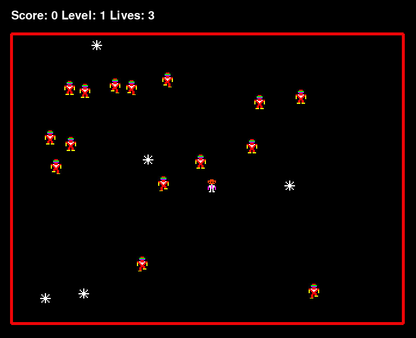

# Robotron 2084 Gym Environment

A faithful recreation of Robotron 2084 (Xbox 360 / arcade version) as a [Gymnasium](https://gymnasium.farama.org/) environment for reinforcement learning research.



The goal is to train an RL agent on this environment and deploy it to play the Xbox 360 version on real hardware.

(See [the training project](https://github.com/stridera/robotron) for RL training code.)

## Installation

### Poetry (Recommended)

```bash
git clone git@github.com:stridera/robotron-2084.git
cd robotron-2084/

poetry install
poetry shell
```

### pip

```bash
git clone git@github.com:stridera/robotron-2084.git
cd robotron-2084/

python3 -m venv .venv
source .venv/bin/activate
pip install -r requirements.txt
```

**Requirements:** Python 3.10+ | Linux, macOS, or Windows (WSL recommended)

## Playing as a Human

```bash
python main.py [options]
```

| Option | Default | Description |
|--------|---------|-------------|
| `--level` | 1 | Starting level (1-40) |
| `--lives` | 3 | Number of lives |
| `--fps` | 30 | Frame rate |
| `--godmode` | off | Invincibility (can't die) |

**Controls:**
- **WASD** - Move
- **IJKL** - Shoot
- **Enter** - Restart
- **Escape / Q** - Quit
- **Gamepad** - Left stick to move, face buttons (A/B/X/Y) to shoot

## Using as a Gymnasium Environment

### Quick Start

```python
from robotron import RobotronEnv

env = RobotronEnv(headless=True, fps=0, always_move=True)
obs, info = env.reset(seed=42)

while True:
    action = env.action_space.sample()  # Replace with your agent
    obs, reward, terminated, truncated, info = env.step(action)
    if terminated:
        break

env.close()
```

### Environment Parameters

| Parameter | Type | Default | Description |
|-----------|------|---------|-------------|
| `level` | int | 1 | Starting level (1-40) |
| `lives` | int | 3 | Number of lives |
| `fps` | int | 0 | Frames per second (0 = unlimited for training) |
| `headless` | bool | True | Off-screen rendering (no window, still returns observations) |
| `always_move` | bool | False | Reduce action space from 81 to 64 (removes no-op) |
| `godmode` | bool | False | Invincibility for debugging |
| `config_path` | str | None | Path to custom config YAML |
| `render_mode` | str | None | `'human'` (pygame window) or `'rgb_array'` |

### Action Space

The action space combines movement and shooting into a single discrete value:

```
action = movement_direction * num_directions + shoot_direction
```

**Default (`always_move=False`): Discrete(81)**
- 9 movement directions x 9 shooting directions
- Direction encoding: 0=None, 1=Up, 2=UpRight, 3=Right, 4=DownRight, 5=Down, 6=DownLeft, 7=Left, 8=UpLeft

**With `always_move=True`: Discrete(64)**
- 8 movement directions x 8 shooting directions (no-op removed from both)
- Same direction encoding but starting at 1

### Observation Space

- **Type:** `Box(0, 255, (492, 665, 3), uint8)` — RGB image of the play area
- Cropped to just the game arena (no score/UI chrome)

### Rewards

| Event | Reward |
|-------|--------|
| Kill enemy | `points / 100.0` (e.g. Grunt=1.0, Brain=5.0) |
| Collect family | `1000-5000 / 100.0` (progressive per wave) |
| Player death | `-1.0` |

### Info Dictionary

Each `step()` and `reset()` returns an info dict:

```python
{
    'score': int,        # Total score
    'level': int,        # Current level (0-indexed)
    'lives': int,        # Lives remaining
    'family': int,       # Family members remaining on this wave
    'data': list         # [(x, y, 'ClassName'), ...] for all sprites
}
```

The `data` field provides structured sprite positions relative to the play area, useful for non-vision agents or reward shaping.

## RL Training Integration

### Stable Baselines3

```python
from stable_baselines3 import PPO
from stable_baselines3.common.vec_env import SubprocVecEnv, VecFrameStack
from stable_baselines3.common.atari_wrappers import ClipRewardEnv
from gymnasium.wrappers import GrayscaleObservation, ResizeObservation
from robotron import RobotronEnv

def make_env(seed):
    def _init():
        env = RobotronEnv(
            headless=True,
            fps=0,
            always_move=True,
            lives=5,
            config_path='path/to/training_config.yaml',
        )
        env = GrayscaleObservation(env, keep_dim=True)
        env = ResizeObservation(env, shape=(84, 84))
        env.reset(seed=seed)
        return env
    return _init

# 8 parallel environments
env = SubprocVecEnv([make_env(seed=i) for i in range(8)])
env = VecFrameStack(env, n_stack=4)

model = PPO("CnnPolicy", env, verbose=1)
model.learn(total_timesteps=10_000_000)
```

### Training Config Recommendations

For RL training, use a config that disables visual effects and transition pauses (wasted frames where the agent can't act):

```yaml
# In your training config YAML:
effects_enabled: false
warp_in_duration: 0
death_duration: 0
level_complete_duration: 0
```

See `robotron/engine/config.yaml` for all available options.

### Key Tips

- **`fps=0`** and **`headless=True`** for maximum throughput (~500-1000 FPS)
- **`always_move=True`** reduces the action space from 81 to 64
- **Multiple lives** (e.g. `lives=5`) lets the agent learn from mistakes
- **Seeding**: pass `seed` to `env.reset()` for reproducibility
- **Frame stacking**: stack 4 frames for temporal information (velocity, direction)
- **Grayscale + resize** to 84x84 matches standard Atari preprocessing

## Configuration

All game parameters are controlled via YAML config files. Pass a custom config with:

```python
env = RobotronEnv(config_path='my_config.yaml')
```

### Key Config Options

| Option | Default | Description |
|--------|---------|-------------|
| `effects_enabled` | `true` | Border color cycling, warp-in tinting, level complete flash |
| `warp_in_duration` | `30` | Frames for enemy warp-in animation (0 to disable) |
| `death_duration` | `30` | Frames to pause on player death (0 to disable) |
| `level_complete_duration` | `20` | Frames to pause after clearing a wave (0 to disable) |
| `extra_life_score` | `-1` | Points per extra life (-1 to disable) |

### Per-Entity Config

Each enemy type has configurable speed, score value, spawn rates, etc:

```yaml
grunt:
    score: 100
    speed: 7
    move_delay: [5, 25]        # Random delay range between moves
    speed_up_interval: 300     # Frames between acceleration steps
    min_move_delay: 1          # Fastest possible move delay

sphereoid:
    score: 1000
    spawn_counts: [1, 5]       # Random range of enforcers to spawn
    max_active_spawns: 8       # Max enforcers on screen at once
```

### Provided Configs

| File | Purpose |
|------|---------|
| `robotron/engine/config.yaml` | Default — close to arcade with effects enabled |
| `robotron/engine/config.yaml.default` | Original arcade-accurate settings |

### Waves

Each wave defines the enemy composition as a 9-element list:

```yaml
waves:
    # [Grunts, Electrodes, Hulks, Brains, Sphereoids, Quarks, Mommies, Daddies, Mikeys]
    - [15, 5, 0, 0, 0, 0, 1, 1, 0]   # Wave 1
    - [17, 15, 5, 0, 1, 0, 1, 1, 1]   # Wave 2
    # ... up to 40 waves, then repeats from wave 20
```

## Game Mechanics

### Entities

| Entity | Behavior | Score |
|--------|----------|-------|
| **Grunt** | Chases player, speeds up over time | 100 |
| **Electrode** | Stationary obstacle, kills grunts on contact | 25 |
| **Hulk** | Immortal, moves randomly, crushes family/electrodes, knocked back by bullets | 0 |
| **Brain** | Flies toward family, brainwashes them into Progs, shoots cruise missiles | 500 |
| **Sphereoid** | Flies in wavy patterns, spawns Enforcers (max 8 on screen) | 1000 |
| **Enforcer** | Flies toward player, shoots predictive sparks | 350 |
| **Quark** | Moves diagonally, spawns Tanks (max 8 on screen) | 1000 |
| **Tank** | Drives toward player, shoots bouncing shells | 350 |
| **Family** | Mommy/Daddy/Mikey — rescue for progressive bonus (1k-5k) | 1000-5000 |
| **Prog** | Brainwashed human, chases player | 200 |

### Level Progression

- Clear all killable enemies (Grunts, Brains, Sphereoids, Enforcers, Quarks, Tanks, Progs) to advance
- 40 waves, then repeats from wave 20
- Family collection bonus resets each wave or on death

### Spawner Mechanics

Sphereoids and Quarks are generators that spawn Enforcers and Tanks respectively:
- Each generator spawns a random number of enemies (configurable, default 1-5)
- **Max 8 active spawns** on screen at once per type — if slots are full, the generator waits (this is a known exploit in the arcade)
- When a generator exhausts its spawns, it vanishes but stays alive until all its spawns are destroyed
- On player death: all spawns are killed, generators reappear with fresh spawn counts

## Reproducibility

Full deterministic replay with seeding:

```python
env1 = RobotronEnv(headless=True)
env2 = RobotronEnv(headless=True)

obs1, _ = env1.reset(seed=42)
obs2, _ = env2.reset(seed=42)

for _ in range(100):
    action = 42
    obs1, _, _, _, _ = env1.step(action)
    obs2, _, _, _, _ = env2.step(action)
    assert (obs1 == obs2).all()  # Identical
```

## Examples

See [`examples/`](examples/) for runnable code:

- **`basic_usage.py`** — Gymnasium API basics
- **`reproducibility_demo.py`** — Proving deterministic seeding
- **`performance_comparison.py`** — Headless vs rendered benchmarks
- **`custom_config.py`** — Custom game configurations

```bash
python examples/basic_usage.py
```

## Development

```bash
# Run tests
poetry run pytest

# Format
poetry run black .

# Lint
poetry run ruff check .

# Type check
poetry run mypy robotron/
```

## Attributions and Thanks

- Robotron 2084. Developed by Eugene Jarvis and Larry DeMar. Published by Williams Electronics.
- Sprite Sheet and definitions are from [Sean Riddle's Ripper page](https://seanriddle.com/ripper.html).
- Notes, score info, etc from [IGN's Robotron 2084 FAQ](https://www.ign.com/faqs/2005/robotron-2084-general-faq-430788)
